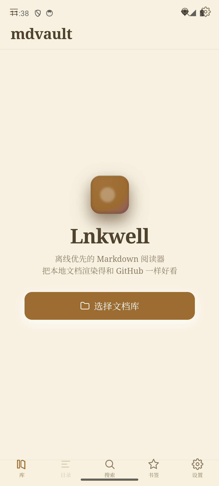
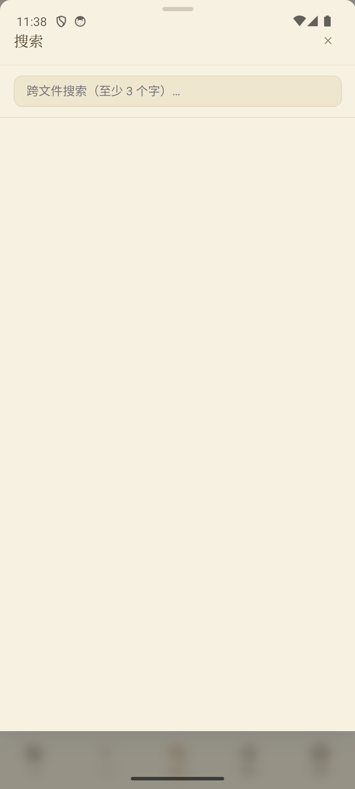
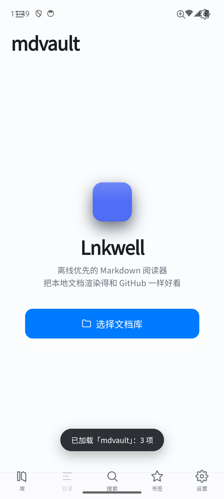

# Lnkwell

**An offline-first Markdown reader** — not an editor.

[中文](README.md) · [English](README.en.md)

[](LICENSE)
[](https://github.com/maoxiaojie1/lnkwell/actions/workflows/ci.yml)
[](https://tauri.app)
[](https://svelte.dev)
[](#download)

Renders the `.md` files in a local folder with GitHub-grade typography: syntax highlighting, LaTeX math,
Mermaid diagrams, inline `<svg>`, relative-path images, outline navigation, full-text search and reading
progress. Fully offline — nothing is uploaded anywhere.

Mobile-first: **Android is the primary target**, while Windows / macOS / Linux builds work as well.

| Library | Search | Reading |
|---|---|---|
|  |  |  |

## Why another Markdown app

Because reading and writing are different products. Lnkwell only reads:

- **Read-only** — no editing, no autosave, no merge conflicts; this also sidesteps Tauri's known
  problems writing to Android `content://` URIs.
- **Local-first** — your library *is* a folder on disk. No import, no conversion, no copy.
- **Rendering lives in Rust** — parsing, chunking and sanitizing are pure computation and never block the UI thread.

## Features

**Rendering**

- GitHub-flavored: heading anchors, tables, task lists, footnotes, syntax highlighting (highlight.js)
- LaTeX math (KaTeX), Mermaid diagrams (lazy), GitHub alerts (`[!NOTE]` / `[!TIP]` / `[!WARNING]` …)
- Inline `<svg>` source rendered directly, including in PDF exports
- Relative images rewritten to an `md-rel://` sentinel and resolved natively (desktop `std::path`, Android SAF)
- Long documents are split by top-level `h2`; only the first 2–3 chunks are injected upfront

**Reading**

- Outline: a resizable in-flow sidebar on desktop, a full-screen sheet on narrow screens; the in-document
  `[TOC]` card hides automatically while the outline is visible
- Reading progress, paragraph-level bookmarks, multiple vaults and a recent list
- Font size and page zoom (`Ctrl wheel` / `Ctrl ±` / `Ctrl 0`) scaling text and images together
- Read-only source view, side-by-side split, image viewer, drag-and-drop files or folders
- PDF export on Windows via WebView2 `PrintToPdf` (no header/footer)

**Search**

- Full-text search over SQLite FTS5 `trigram`, jumping straight to the matching chunk
- In-document find (`Ctrl F` / `F3`) with match count

**Platforms**

- Android: SAF file access, `WindowInsets` safe areas, hardware back button handling, share/deep-link intake
- Windows: WebView2, single-instance forwarding, `.md` file association
- macOS / Linux: buildable from source, no prebuilt binaries yet

## Download

See [Releases](https://github.com/maoxiaojie1/lnkwell/releases).

| Platform | File | Notes |
|---|---|---|
| Windows | `Lnkwell_x.y.z_x64_zh-CN.msi` | Installer (recommended), associates `.md` |
| Windows | `Lnkwell_x.y.z_x64-setup.exe` | NSIS installer, same behavior |
| Windows | `lnkwell.exe` | Portable single executable |
| Android | `Lnkwell-x.y.z-arm64-v8a.apk` | Physical devices (arm64) |

## Build from source

Requirements: Node.js ≥ 20, Rust ≥ 1.77.2, plus the
[Tauri system dependencies](https://tauri.app/start/prerequisites/) for your platform.

```bash
npm install
npm run tauri dev       # development
npm run tauri build     # bundle installers for the current platform
```

Android additionally requires generating the project and configuring the NDK — see
[docs/development.md](docs/development.md) (Chinese).

## Keyboard shortcuts

| Shortcut | Action |
|---|---|
| `Ctrl K` | Global search (↑↓ to select, Enter to open) |
| `Ctrl F` | Find in document |
| `F3` / `Shift F3` | Next / previous match |
| `Ctrl D` | Bookmark the current paragraph |
| `Ctrl O` | Open folder |
| `Ctrl Shift T` | Toggle the right outline |
| `Ctrl /` | Toggle read-only source view |
| `Ctrl +` / `Ctrl -` / `Ctrl 0` | Zoom in / out / reset (`Ctrl 0` = 100%) |
| `Ctrl wheel` | Continuous zoom in the reading pane |
| `Esc` | Close the current panel, or go back |

## Design notes

**Rendering and parsing live in separate layers.** Rust handles one-shot, pure-compute, filesystem-facing
work (parse, chunk, sanitize, read). The frontend handles everything that needs a real DOM (KaTeX,
highlight.js, Mermaid, scrolling and progress).

**Relative paths are resolved once, in Rust.** During rendering `` becomes a platform-agnostic
`md-rel://` sentinel; the `resolve_entry` command resolves it (`std::path` on desktop, SAF
`resolve_file_uri` on Android). The frontend never concatenates paths.

**Chunked by top-level `h2` with sentinel lazy loading.** Only the first 2–3 chunks are injected initially;
an `IntersectionObserver` appends the rest. Outline entries carry their chunk index, so jumping renders
exactly the needed chunk instead of probing sequentially.

**The outline shares a layer with the document.** On desktop it is a flex sibling that can be resized and
collapsed — the document yields width instead of being covered by an overlay. Only on narrow screens does
it degrade into a full-screen drawer.

**Read-only by design.** No undo stack, no autosave, no conflict detection.

## Tech stack

| Layer | Choice | Notes |
|---|---|---|
| App framework | Tauri 2 | Rust backend + system WebView |
| Frontend | Svelte 5 + Vite + TypeScript | Runes state, `{@html}` injection |
| Markdown | `pulldown-cmark` | Parsed in Rust, pure computation |
| Sanitizing | `ammonia` | Allowlist-based, defends against XSS |
| Math / diagrams | KaTeX / Mermaid | Rendered in the frontend, Mermaid lazy-loaded |
| Persistence | `tauri-plugin-sql` (SQLite + FTS5 trigram) | Progress, bookmarks, full-text index |
| File access | Custom commands + `tauri-plugin-android-fs` | `std::fs` on desktop, SAF on Android |

## Project layout

```
src/                       # Svelte frontend
├── components/            # reader / file tree / drawers / viewer
├── lib/
│   ├── render/            # chunk enhancement: math, highlighting, Mermaid, export styles
│   ├── stores/            # global state (vault / nav / prefs / find)
│   ├── api.ts             # invoke wrappers (mirrors Rust commands)
│   └── db.ts              # SQLite access + schema migrations
src-tauri/src/
├── lib.rs                 # Tauri command wiring
├── markdown.rs            # render pipeline: preprocess → chunk → sanitize
├── vault/                 # platform file access (desktop / android)
└── error.rs               # unified error type with codes
fixtures/cases/            # rendering regression fixtures (crlf / gbk / xss / fences / nesting / paths)
docs/                      # design, improvement plan, build docs
```

## Known limitations

- Single file limit 10 MB (images 32 MB)
- Full-text queries need **at least 3 characters** (FTS5 `trigram`)
- Android SAF exposes no stable mtime, so the index is rebuilt on every launch
- A single file shared into the app on Android belongs to no vault, so its relative images cannot resolve
- PDF export is Windows-only
- External links open in the system browser; there is no in-app browser

## Documentation

- [Technical design](docs/design.md) (Chinese) — background, trade-offs, risk list
- [Improvement plan](docs/improvement-plan.md) (Chinese) — review findings and phased tasks
- [Development & build](docs/development.md) (Chinese) — packaging, signing, safe areas, pitfalls
- [Changelog](CHANGELOG.md)

## Contributing

Issues and pull requests are welcome. Please read [CONTRIBUTING.md](CONTRIBUTING.md) first (Chinese);
report security issues privately as described in [SECURITY.md](SECURITY.md).

## License

[MIT](LICENSE) © lnkwell contributors
