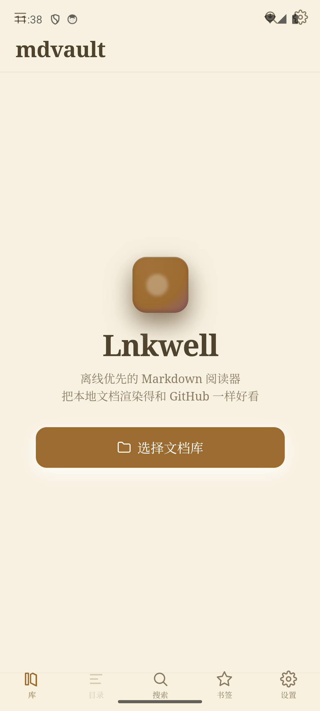

# Lnkwell

离线优先的 Markdown **阅读器**（不是编辑器）。把本地文件夹里的 `.md` 渲染得和 GitHub 一样好看：代码高亮、LaTeX 公式、Mermaid 图表、相对路径图片、目录导航、全文搜索、阅读进度。

目标平台：**Android（主）** / Windows / macOS / Linux。



## 技术栈

| 层 | 选择 | 说明 |
|---|---|---|
| 应用框架 | Tauri 2 | Rust 后端 + 系统 WebView |
| 前端 | Svelte 5 + Vite + TypeScript | Runes 状态，`{@html}` 注入渲染结果 |
| Markdown | `pulldown-cmark` | Rust 侧解析，纯计算，不阻塞 UI |
| 消毒 | `ammonia` | 白名单清洗，防 XSS（WebView 持有 IPC 通道） |
| 公式 / 图表 | KaTeX / Mermaid | 前端渲染，Mermaid 懒加载 |
| 持久化 | `tauri-plugin-sql`（SQLite + FTS5 trigram） | 进度、书签、全文索引 |
| 文件访问 | 自定义命令 + `tauri-plugin-android-fs` | 桌面 `std::fs`，Android SAF |

## 开发

```bash
npm install            # 前端依赖
npm run check          # svelte-check 类型检查
npm run dev            # 仅前端（无 Tauri API 会报错，用于调样式）
npm run tauri dev      # 完整应用（桌面）

cd src-tauri
cargo test             # Rust 单测 + fixtures 回归
cargo check --target aarch64-linux-android --lib   # Android 专属代码的类型检查
```

检索层的 SQL（FTS5 外部内容表、触发器、迁移）无法在 TS 侧断言，用脚本验证：

```bash
python scripts/verify-fts.py   # 24 项断言，含老库迁移
```

### Windows 打包

```bash
npm run tauri build                    # exe + 全部安装包
npm run tauri build -- --bundles nsis  # 只做 NSIS 安装包
npx tauri bundle --bundles msi         # 复用已编译 exe，只重新打包（不重编译）
```

产物：

| 路径 | 说明 |
|---|---|
| `src-tauri/target/release/lnkwell.exe` | 便携版，双击即用 |
| `src-tauri/target/release/bundle/nsis/Lnkwell_*.exe` | NSIS 安装包 |
| `src-tauri/target/release/bundle/msi/Lnkwell_*_zh-CN.msi` | MSI 安装包 |

三个踩过的坑：

1. **Tauri 的 JS 包与 Rust crate 必须同 minor**，否则 CLI 直接拒绝构建。
   当前锁定 `@tauri-apps/api@2.11.1` ↔ `tauri` 2.11.5、`@tauri-apps/plugin-opener@2.5.5` ↔ crate 2.5.5。
   升级任一侧时记得同步另一侧。
2. **WiX 默认 en-US（代码页 1252）装不下中文**：`bundle.fileAssociations` 里的中文描述会让
   `light.exe` 报 `LGHT0311`。已在 `tauri.conf.json` 设 `bundle.windows.wix.language = "zh-CN"`。
3. **首次打包要下载 NSIS 工具链**（GitHub），而 CLI 不读 Windows 系统代理，
   需显式设置 `HTTP_PROXY` / `HTTPS_PROXY` 环境变量。

Android：

```powershell
.\scripts\build-android.ps1
```

## 目录结构

```
src/                       # Svelte 前端
├── components/            # 阅读器 / 文件树 / 抽屉 / 查看器
├── lib/
│   ├── render/            # 分块增强：公式、高亮、Mermaid、导出样式
│   ├── stores/            # 全局状态（vault / nav / prefs / find）
│   ├── api.ts             # invoke 封装（与 Rust 命令一一对应）
│   ├── db.ts              # SQLite 访问 + schema 迁移
│   └── display.ts         # entry 句柄的展示工具
src-tauri/src/
├── lib.rs                 # Tauri 命令装配
├── markdown.rs            # 渲染管线：预处理 → 分块 → 消毒
├── vault/                 # 平台文件访问（desktop / android 编译期分发）
└── error.rs               # 带 code 的统一错误
fixtures/cases/            # 渲染回归样本（crlf / gbk / xss / 围栏 / 嵌套 / 路径）
docs/                      # 技术方案与改进计划
```

## 设计要点

**渲染与解析分居两层。** Rust 只做「一次性、纯计算、和文件系统打交道」的事（解析、切块、消毒、读文件）；前端只做「需要真实 DOM」的事（KaTeX、highlight.js、Mermaid、滚动与进度）。

**相对路径只在 Rust 解析一次。** 渲染期把 `` 改写成平台无关的 `md-rel://` 哨兵，真正解析由 `resolve_entry` 命令完成：桌面走 `std::path`，Android 走 SAF `resolve_file_uri`。前端不做任何路径拼接。

**按顶层 H2 分块 + 哨兵懒加载。** 首屏只注入 2–3 块，其余由 `IntersectionObserver` 追加；TOC 项携带所属块号，跳转时一步渲染到位，长文档不必逐块探测。

**目录栏与正文同层。** 桌面端右侧目录是 flex 兄弟节点（可展开/收缩，正文让出宽度，不是遮罩浮层），工具栏按钮或 `Ctrl+Shift+T` 切换；窄屏空间不足时才退化为全屏抽屉。

**只读定位。** 不做编辑，因此不需要撤销栈、自动保存、冲突检测；同时绕开了 Tauri 在 Android 上写 `content://` URI 的已知缺陷。

## 已知限制

- 单个文件上限 10MB（图片 32MB），超限直接拒绝以防 OOM。
- 搜索基于 FTS5 `trigram` 分词，**查询词至少 3 个字符**。
- Android SAF 不提供稳定的 mtime，索引无法增量更新，每次启动会重建。
- Android 上「分享进来的单文件」不属于任何文档库，其相对图片无法解析。
- PDF 导出仅 Windows（WebView2 `PrintToPdf`）。
- 外链通过系统浏览器打开；应用内不内置浏览器。

## 文档

- [技术方案](Tauri-Markdown阅读器-技术方案.md) — 背景、选型论证、风险清单
- [架构改进计划](docs/架构改进计划.md) — 评审结论、分阶段任务与验收标准
