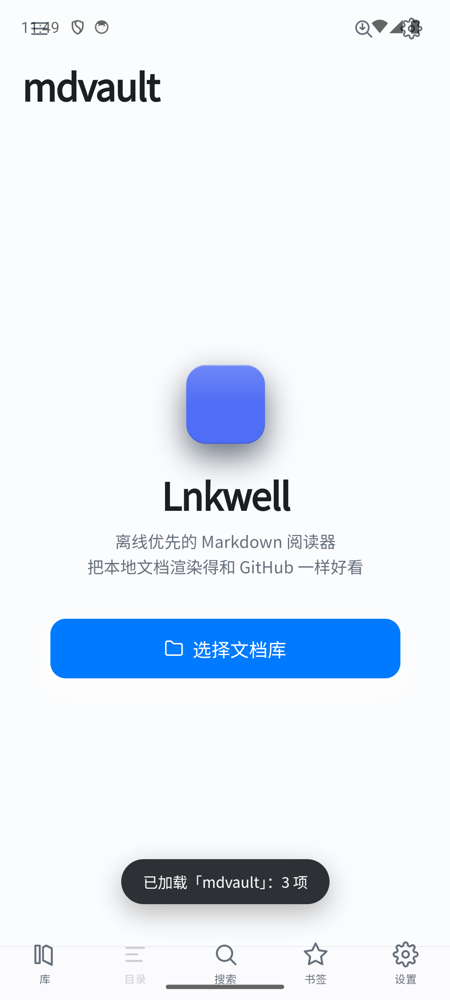

# Lnkwell

**离线优先的 Markdown 阅读器**（不是编辑器）。

[中文](README.md) · [English](README.en.md)

[](LICENSE)
[](https://github.com/maoxiaojie1/lnkwell/actions/workflows/ci.yml)
[](https://tauri.app)
[](https://svelte.dev)
[](#下载)

把本地文件夹里的 `.md` 渲染得和 GitHub 一样好看：代码高亮、LaTeX 公式、Mermaid 图表、内嵌 `<svg>` 图、
相对路径图片、目录导航、全文搜索、阅读进度。全部离线，不联网、不上传任何文件。

目标是 **Android 优先** 的移动阅读体验，桌面端（Windows / macOS / Linux）同样可用。

| 文档库 | 搜索 | 阅读 |
|---|---|---|
|  |  |  |

## 为什么不直接开编辑器

因为「读」和「写」是两种不同的产品。Lnkwell 只做读：

- **只读** —— 没有编辑、没有自动保存、没有冲突合并，也绕开了 Tauri 在 Android 上写 `content://` 的缺陷；
- **本地优先** —— 文档库就是你磁盘上的文件夹，不导入、不转格式、不留副本；
- **渲染在 Rust** —— 解析、切块、消毒都是纯计算，不抢 UI 线程。

## 功能

**渲染**

- GitHub 风格：标题锚点、表格、任务列表、脚注、代码高亮（highlight.js）
- LaTeX 公式（KaTeX）、Mermaid 图表（懒加载）、GitHub Alert（`[!NOTE]` / `[!TIP]` / `[!WARNING]` …）
- 内嵌 `<svg>` 源码直接渲染，导出 PDF 时同样生效
- 相对路径图片：渲染期改写成 `md-rel://` 哨兵，由后端按平台解析（桌面 `std::path`、Android SAF）
- 长文档按顶层 H2 分块，首屏只注入 2–3 块，其余滚动到位再渲染

**阅读**

- 右侧大纲：桌面端为可拖拽宽度的同层侧栏，窄屏退化为全屏抽屉；文内 `[TOC]` 与大纲自动互斥
- 阅读进度、段落级书签、多文档库切换与「最近打开」
- 字号调节与页面缩放（`Ctrl 滚轮` / `Ctrl ±` / `Ctrl 0`），正文和图片一起缩放
- 只读源码视图、并排对照、图片查看器、拖拽打开文件或文件夹
- 导出 PDF（Windows，走 WebView2 `PrintToPdf`，无页眉页脚）

**检索**

- SQLite FTS5 `trigram` 全文搜索，命中定位到具体块
- 文档内查找（`Ctrl F` / `F3`），带命中计数

**平台**

- Android：SAF 文件访问、`WindowInsets` 安全区、物理返回键接管、分享与深链打开
- Windows：WebView2、单实例转发（双击 `.md` 时唤醒已有窗口）、文件关联
- macOS / Linux：可从源码构建，暂无预编译包

## 下载

最新版本见 [Releases](https://github.com/maoxiaojie1/lnkwell/releases)。

| 平台 | 文件 | 说明 |
|---|---|---|
| Windows | `Lnkwell_x.y.z_x64_zh-CN.msi` | 安装版（推荐），自动关联 `.md` |
| Windows | `Lnkwell_x.y.z_x64-setup.exe` | NSIS 安装包，行为同上 |
| Windows | `lnkwell.exe` | 便携版，单文件免安装 |
| Android | `Lnkwell-x.y.z-arm64-v8a.apk` | 真机（arm64） |

Linux / macOS 需要自行构建，见下节。

## 从源码运行

前置依赖：Node.js ≥ 20、Rust ≥ 1.77.2，以及 [Tauri 的系统依赖](https://tauri.app/start/prerequisites/)。

```bash
npm install
npm run tauri dev       # 开发模式
npm run tauri build     # 打包当前平台的安装包
```

Android 需要额外生成工程与 NDK 配置，步骤见 [docs/development.md](docs/development.md)。

## 快捷键

| 快捷键 | 作用 |
|---|---|
| `Ctrl K` | 全局搜索（↑↓ 选择、Enter 打开） |
| `Ctrl F` | 文档内查找 |
| `F3` / `Shift F3` | 下一个 / 上一个匹配 |
| `Ctrl D` | 收藏当前阅读位置（段落级书签） |
| `Ctrl O` | 打开文件夹 |
| `Ctrl Shift T` | 展开 / 收起右侧大纲 |
| `Ctrl /` | 切换只读源码视图 |
| `Ctrl +` / `Ctrl -` / `Ctrl 0` | 放大 / 缩小 / 重置页面缩放（`Ctrl 0` = 100%） |
| `Ctrl 滚轮` | 在阅读区连续缩放正文 |
| `Esc` | 关闭当前面板，或返回上一篇 |

## 设计要点

**渲染与解析分居两层。** Rust 只做「一次性、纯计算、和文件系统打交道」的事（解析、切块、消毒、读文件）；
前端只做「需要真实 DOM」的事（KaTeX、highlight.js、Mermaid、滚动与进度）。

**相对路径只在 Rust 解析一次。** 渲染期把 `` 改写成平台无关的 `md-rel://` 哨兵，
真正解析由 `resolve_entry` 命令完成：桌面走 `std::path`，Android 走 SAF `resolve_file_uri`。
前端不做任何路径拼接。

**按顶层 H2 分块 + 哨兵懒加载。** 首屏只注入 2–3 块，其余由 `IntersectionObserver` 追加；
TOC 项携带所属块号，跳转时一步渲染到位，长文档不必逐块探测。

**目录栏与正文同层。** 桌面端右侧目录是 flex 兄弟节点（可展开/收缩，正文让出宽度，不是遮罩浮层），
工具栏按钮或 `Ctrl+Shift+T` 切换；窄屏空间不足时才退化为全屏抽屉。

**只读定位。** 不做编辑，因此不需要撤销栈、自动保存、冲突检测。

## 技术栈

| 层 | 选择 | 说明 |
|---|---|---|
| 应用框架 | Tauri 2 | Rust 后端 + 系统 WebView |
| 前端 | Svelte 5 + Vite + TypeScript | Runes 状态，`{@html}` 注入渲染结果 |
| Markdown | `pulldown-cmark` | Rust 侧解析，纯计算，不阻塞 UI |
| 消毒 | `ammonia` | 白名单清洗，防 XSS（WebView 持有 IPC 通道） |
| 公式 / 图表 | KaTeX / Mermaid | 前端渲染，Mermaid 懒加载 |
| 持久化 | `tauri-plugin-sql`（SQLite + FTS5 trigram） | 进度、书签、全文索引 |
| 文件访问 | 自定义命令 + `tauri-plugin-android-fs` | 桌面 `std::fs`，Android SAF |

## 项目结构

```
src/                       # Svelte 前端
├── components/            # 阅读器 / 文件树 / 抽屉 / 查看器
├── lib/
│   ├── render/            # 分块增强：公式、高亮、Mermaid、导出样式
│   ├── stores/            # 全局状态（vault / nav / prefs / find）
│   ├── api.ts             # invoke 封装（与 Rust 命令一一对应）
│   └── db.ts              # SQLite 访问 + schema 迁移
src-tauri/src/
├── lib.rs                 # Tauri 命令装配
├── markdown.rs            # 渲染管线：预处理 → 分块 → 消毒
├── vault/                 # 平台文件访问（desktop / android 编译期分发）
└── error.rs               # 带 code 的统一错误
fixtures/cases/            # 渲染回归样本（crlf / gbk / xss / 围栏 / 嵌套 / 路径）
docs/                      # 技术方案、改进计划、构建文档
```

## 已知限制

- 单文件上限 10MB（图片 32MB），超限直接拒绝以防 OOM
- 全文搜索基于 FTS5 `trigram` 分词，**查询词至少 3 个字符**
- Android SAF 不提供稳定的 mtime，索引无法增量更新，每次启动会重建
- Android 上「分享进来的单文件」不属于任何文档库，其相对图片无法解析
- PDF 导出仅 Windows
- 外链交给系统浏览器，应用内不内置浏览器

## 文档

- [技术方案](docs/design.md) — 背景、选型论证、风险清单
- [架构改进计划](docs/improvement-plan.md) — 评审结论、分阶段任务与验收标准
- [开发与构建](docs/development.md) — Windows / Android 打包、签名、安全区、踩坑记录
- [更新日志](CHANGELOG.md)

## 参与贡献

欢迎 issue 与 PR。动手前请读 [CONTRIBUTING.md](CONTRIBUTING.md)；安全问题请按 [SECURITY.md](SECURITY.md) 私下报告。

## 许可

[MIT](LICENSE) © lnkwell contributors
